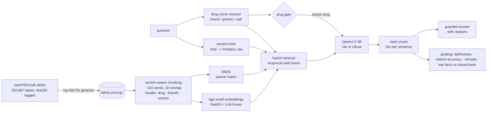

# Ask the Drug Label: retrieval-augmented QA over FDA labels


-purple)

**Live demo: [madhubuddaraju.github.io/drug-label-rag](https://madhubuddaraju.github.io/drug-label-rag/)**
(search runs entirely in your browser; the page also shows every graded LLM answer. Generation takes about
30 seconds per answer on a CPU, so it runs offline in GitHub Actions rather than live.)

A question-answering system over **600 official FDA prescription drug labels** (25,584 passages from openFDA).
Ask *"Can I drink alcohol while taking metronidazole?"* and it retrieves the relevant label passages, answers
from them with numbered citations, and says *"Not found"* when the labels don't cover the question.

The point of the project is the **evaluation**, not the chatbot: every retrieval design choice is measured
against 690 labeled questions, and every generated answer is graded for faithfulness, citation accuracy and
correct refusals.

## Results

### Retrieval (690 labeled questions)

Hit@5 = a passage from the right drug **and** the right label section is in the top 5.

| Configuration | Dev (60) | Held-out (30) | Templated (600) | Hit@1 (all) | ms / query |
|---|---|---|---|---|---|
| BM25 | 30% | 50% | 35% | 18% | 0.7 |
| + chunk headers | 57% | 50% | 61% | 35% | 0.7 |
| + drug-name filter | 75% | 70% | 67% | 40% | 0.8 |
| + section hints | 93% | 77% | 94% | 72% | 0.9 |
| Dense (bge-small) | 67% | 90% | 61% | 45% | 1.2 |
| Dense + chunk headers | 90% | 93% | 91% | 75% | 1.3 |
| Hybrid (RRF) + drug filter | 92% | 90% | 88% | 62% | 2.5 |
| **Hybrid + drug filter + section hints** (chosen) | **95%** | **97%** | **98%** | **86%** | **2.8** |
| same, 1-bit binary embeddings (browser) | 95% | 93% | 97% | 83% | 3.9 |
| same + cross-encoder re-ranker | 97% | 93% | 94% | 79% | 2,394 |

What the ablation shows:
- **Chunk headers are the single biggest win** for both retrievers (dense: 63% → 91% overall hit@5).
- **Keyword search with hand-tuned hints overfits; hybrid doesn't.** BM25 + hints scores 93% on the development
  questions but 77% on the held-out ones. The hybrid configuration holds at 97% on held-out questions.
- **The re-ranker was not worth it.** A general-purpose MS MARCO cross-encoder lowered hit@1 from 86% to 79% and
  made each query ~850x slower. It stays in the ablation table and out of the pipeline.
- **1-bit embeddings cost one point** of hit@5 for a 32x smaller index, which is what makes in-browser semantic
  search possible.
- The top result is about the right drug for **99%** of questions; 14 of 690 miss the top 5, almost all on the right
  drug but a neighbouring section (interaction text often sits under Warnings or Contraindications in real labels).

### Answers (179 questions, graded automatically)

Every answer sentence is checked against the retrieved passages by an NLI model (DeBERTa-v3-base, each passage
sentence and adjacent pair, prefixed with the passage header). Key facts are the facts a pharmacist would expect
in the answer (e.g. "2,550 mg" for metformin's maximum dose), on the 90 hand-written questions.

| Model (4-bit, CPU) | Sentences supported | Key facts | Key facts, guarded | Unanswerable refused, guarded | False refusals, guarded | s / answer |
|---|---|---|---|---|---|---|
| Qwen2.5-1.5B, first prompt | 88% | 63% | 57% | 93% | 12% | 16 |
| Qwen2.5-1.5B | 82% | 71% | 61% | 93% | 16% | 13 |
| **Qwen2.5-3B** | 70% | **82%** | **67%** | **97%** | 16% | 34 |
| Qwen2.5-3B, no retrieval | – | 51% | – | – | – | – |

What the grading showed:
- **Retrieval is what makes the answers right.** The same 3B model recalls 51% of key facts from memory and 82%
  with the label passages. Without retrieval, the 1.5B model said metronidazole is "a safe drug to take
  with alcohol"; with it, the answer cites the disulfiram-like reaction.
- **Small models still add unsupported claims**, so answers go through a two-stage **guardrail**:
  1. *Drug gate*: if the question names no drug in the collection, refuse before generating. Without it the model
     answered "What is the dose of Eliquis?" (not in the corpus) with another drug's dose, a claim the passages
     really did support, so a faithfulness check alone can't catch it. The gate refused 18 of 29 unanswerable
     questions and no answerable ones.
  2. *Claim check*: drop sentences the NLI model can't verify, and refuse if nothing is left. The first prompt
     made the 1.5B model say "Lipitor is generally considered safe to take while pregnant"; the check removed it.
- **The guardrail has a price**: it refuses 16% of answerable questions where the right passage was retrieved,
  and removes some correct sentences the NLI model misses. For drug information that trade-off is the right way
  round, and the dashboard shows every removed sentence so it can be audited.
- **The grader needed fixing too.** Scored against whole 160-word passages, the NLI model rated only 31% of the
  first run's sentences as supported; scored against passage sentences with their header, 88%. Checking the
  checker is part of the work.
- The 3B model writes longer, more detailed answers (51 words on average vs 36) and a larger share of its sentences
  fail the check, but it recalls more key facts and refuses better, so it is the one shown on the dashboard.

## How it works



## Design decisions

**Evaluation first.** Three labeled question sets:
- **600 templated questions** generated from label structure ("Who should not take Zoloft?"), so the gold
  section is known exactly and every section and drug-name type is covered.
- **60 hand-written questions** in everyday wording ("What's the most metformin I can take in a day?"), with the
  gold drug, acceptable sections and key facts the answer must contain. Used to develop the retriever.
- **30 held-out questions**, written only after the retrieval rules were frozen, to check the tuning didn't overfit.
- **Unanswerable questions** (drugs not in the corpus, questions labels don't answer) to test refusal.

**Chunk headers matter more than the model.** Label passages rarely repeat the drug name, so a chunk about
"lactic acidosis" doesn't say "metformin". Prefixing each chunk with *drug · brand names · section* lifts
keyword retrieval from 35% to 60% hit@5 before any embeddings are involved.

**Resolve the drug, then search within it.** Questions name drugs by brand ("Lipitor"), generic ("atorvastatin")
or salt form ("atorvastatin calcium"). An alias index built from the labels maps all of them to one drug, and
retrieval is restricted to that drug's passages. Getting the wrong drug is the most dangerous failure in this
domain, so this is a hard filter, not a soft boost.

**Section hints bridge everyday words and label vocabulary.** People say "kids", "too much", "breastfeeding";
labels say "Pediatric use", "Overdosage", "Lactation". A small, auditable rule list appends the section title to
the query. On keyword search this lifted hand-written hit@5 from 75% to 93%.

**Hybrid retrieval.** BM25 and dense rankings are merged with reciprocal rank fusion. A cross-encoder re-ranker
was tested on top and dropped (see results). Every step is an ablation row in the results table, so each one has
to earn its place.

**Binary quantisation for the browser.** Embeddings are sign-quantised to 1 bit per dimension (384 floats to
48 bytes, 32x smaller) so the whole semantic index ships to the browser. The browser embeds the question with
the ONNX port of the same model (transformers.js), searches with Hamming distance, and fuses with BM25.
A test runs the JavaScript engine in Node and checks it produces exactly the same scores, drug matches and query expansions as the Python one.

**Small open models, strict prompt, measured honestly.** Answers come from Qwen2.5-Instruct 1.5B and 3B (4-bit,
llama.cpp, CPU only, no API keys) with a prompt that requires citations, an exact refusal string and one worked
example. Grading:
- **Faithfulness**: share of answer sentences entailed by the retrieved passages (DeBERTa NLI cross-encoder).
- **Citation accuracy**: do the cited passages come from the right drug and section?
- **Refusals**: correct refusal rate on unanswerable questions, and false refusals when the gold passage was retrieved.
- **Key-fact recall vs closed-book**: the same model answering without retrieval, to show what retrieval adds.

## Quick start

```bash
git clone https://github.com/madhubuddaraju/drug-label-rag.git
cd drug-label-rag
python -m venv .venv && source .venv/bin/activate
make install          # keyword retrieval, evaluation, site, tests
make index-bm25 web   # evaluate BM25 configurations and build the site
make serve            # http://localhost:8000

make install-models   # embeddings, re-ranker, NLI grader, local LLM (CPU)
make index            # embed all passages and evaluate every configuration
make answers          # generate and grade answers (MODEL=qwen2.5-3b, about 2 hours on CPU)
```

The label snapshot, chunks and embeddings are committed, so nothing needs downloading for the steps above.
`make data` (or the **Fetch FDA labels** workflow) rebuilds the snapshot from openFDA (about 1.5 GB).
The heavy steps also run as GitHub Actions workflows: **Build index and evaluate retrieval** and
**Generate and grade answers**.

## Project structure

```
scripts/fetch_labels.py   openFDA bulk download, de-duplication, top-600 drug selection
src/labelrag/
  config.py               models, chunk sizes, section map
  corpus.py               section-aware chunking, tokenizer, drug-name aliases, section hints
  search.py               BM25, dense, binary, hybrid (RRF), drug filter, cross-encoder re-ranking
  evalset.py              templated, hand-written, held-out and unanswerable questions
  evaluate.py             hit@k, MRR, nDCG, drug accuracy, breakdowns
  build.py                embeds the corpus and evaluates every configuration
  generate.py             grounded answers with Qwen2.5 (1.5B or 3B), closed-book baseline
  grade.py                NLI claim check, drug gate, citation and refusal metrics
  web.py                  static site and browser index
dashboard/rag.js          browser search engine (BM25 + binary embeddings + fusion), mirrors the Python
evals/                    labeled question sets
tests/                    chunking, name resolution, retrieval, metrics, grading, guardrail, JS/Python parity
```

## Data

[openFDA drug labeling](https://open.fda.gov/apis/drug/label/) (public domain), the structured product labels
manufacturers submit to the FDA. The 600 prescription generics with the most distinct labels are kept, one label
per drug (the one with the most sections, newest on ties). Snapshot details are in
[`data/labels_meta.json`](data/labels_meta.json).

## Limitations

- **Not medical advice.** Labels can lag the latest version on DailyMed, and generic labels can omit indications
  that are still under patent for the brand.
- One label per drug: different strengths or formulations can have different dosing.
- The hand-written question sets are small (90 questions); confidence intervals on them are wide.
- Small models (1.5B/3B) are used deliberately so everything runs free on CPU; larger models would answer better.
- The NLI judge is itself a model: it lets a few weak sentences through and rejects some correct ones.

## License

MIT for the code. openFDA data is public domain.
